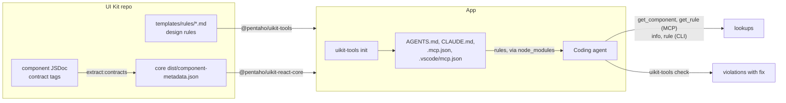

# @pentaho/uikit-tools

Tools for apps built with HV UI Kit and the coding agents that work on them:

- **The UI Kit design rules**, in [templates/rules](templates/rules), which agents read before writing UI.
- **Lookups** of components and design rules, from the command line or over MCP. Both return the same text.
- **`init`**, which points the project's agents at the rules and the MCP server.
- **`check`**, which finds code that breaks the design rules that have checks.

Component props and guidance are read from the metadata shipped in the installed `@pentaho/uikit-react-core` (`dist/component-metadata.json`), so they always match the UI Kit version the app uses. The design follows the HVUIKIT-7492 architecture decision.

## Set up an app

```bash
npm install --save-dev @pentaho/uikit-tools
npx --no-install uikit-tools init
```

`init` writes:

| File               | Content                                                                                                                                                                                    |
| ------------------ | ------------------------------------------------------------------------------------------------------------------------------------------------------------------------------------------ |
| `AGENTS.md`        | A marked block that imports each rule file from the installed tools (`@node_modules/@pentaho/uikit-tools/templates/rules/<file>.md`) and lists the commands. The rest of the file is kept. |
| `CLAUDE.md`        | `@AGENTS.md`, added if missing, so Claude Code loads the same block.                                                                                                                       |
| `.mcp.json`        | The `hv-uikit` MCP server for Claude Code. Other servers are kept.                                                                                                                         |
| `.vscode/mcp.json` | The `hv-uikit` MCP server for Copilot. Other servers are kept.                                                                                                                             |

Nothing is copied. Upgrading `@pentaho/uikit-tools` updates the rules and upgrading `@pentaho/uikit-react-core` updates the component guidance, without running `init` again. Use `--agents claude` or `--agents copilot` to set up one agent.

## Commands

| Command                        | Output                                                                                                                                                                                                                       |
| ------------------------------ | ---------------------------------------------------------------------------------------------------------------------------------------------------------------------------------------------------------------------------- |
| `uikit-tools info <Component>` | Import, props and design guidance (variants, states, tokens, don'ts, accessibility). `info dialog` and `info HvDialog` both work; close names are suggested.                                                                 |
| `uikit-tools components`       | Every component with a one-line description; `--limit` and `--offset` page through them.                                                                                                                                     |
| `uikit-tools rules`            | Every design rule section by id (`<file>/<section>`), marking the ones `check` finds.                                                                                                                                        |
| `uikit-tools rule <id>`        | A rule section as written (`rule tokens/colors`), with the fix for checked rules, or a whole rule file (`rule tokens`).                                                                                                      |
| `uikit-tools check [paths...]` | Violations of the rules that have checks. Paths are files, folders or quoted globs (`'src/**/*.tsx'`), default `src`. `--format json` for a report; `--rules a,b` to limit; exit code 0 clean, 1 violations, 2 couldn't run. |
| `uikit-tools mcp`              | The `hv-uikit` MCP server on stdio, with `list_components`, `get_component`, `list_rules` and `get_rule`, which return the same text as `components`, `info`, `rules` and `rule`.                                            |

## Checks

One check per rule section that can be checked, in [src/checks/rules](src/checks/rules). Rule ids are the rule file and section heading, so `tokens/colors` is the "Colors" section of [tokens.md](templates/rules/tokens.md).

| Rule                                                 | Finds                                                                                                                                                                |
| ---------------------------------------------------- | -------------------------------------------------------------------------------------------------------------------------------------------------------------------- |
| `anti-patterns/prefer-ui-kit-components`             | Native `button`, `input`, `select`, `textarea`, `table`, `dialog` and `progress` elements. Semantic elements such as headings are fine.                              |
| `actions/prevent-accidental-and-destructive-actions` | Delete, remove and discard triggers whose handler deletes straight away (followed one function deep), in files that offer no undo and don't ask with `confirm()`     |
| `tokens/colors`                                      | Raw hex, `rgb()`, `hsl()` and named colors in style objects, CSS-in-JS, arbitrary utility classes and stylesheets; on `Hv*` color props only hex and color functions |
| `tokens/spacing`                                     | Raw px, rem and em in spacing styles and `sx` string shorthands (`p: "12px"`), and spacing classes off the scale (`p-[13px]`, `mt-4`, `mt-12px`)                     |

The checks are static heuristics. They can miss a violation they can't see, or flag a harmless one, and the other rules have no check, so a clean result doesn't mean every rule is met. Each check has good and bad samples in [test-fixtures/checks](test-fixtures/checks); the lines that must be reported are marked `✗`.

### Adding a check

1. Add `src/checks/rules/<name>.ts` exporting a `Check` whose `source` names the rule file and its `## ` section, and list it in [registry.ts](src/checks/registry.ts).
2. Add a fixture folder named after the rule id, with `/` as `-` (more than one: add `-<case>`), with sample files under `src/`, and mark each line that must be reported with `✗`.
3. Run `npm test -w packages/tools`. The tests fail if a check points at a section that doesn't exist, or a check has no fixture.

## End-to-end flow



| Step              | Who               | What happens                                                                                                                                                                                 | Tested by                                                |
| ----------------- | ----------------- | -------------------------------------------------------------------------------------------------------------------------------------------------------------------------------------------- | -------------------------------------------------------- |
| 1. Write rules    | Rule owners       | One file per topic in `templates/rules`, one `## ` section per rule. A rule's id is its file and section: `tokens/colors`.                                                                   | `checks.test.ts`: each check names a section that exists |
| 2. Write guidance | UI Kit developers | JSDoc contract tags on the component (see `.github/instructions/component-contracts.instructions.md`). The core build runs `extract:contracts`, which writes `dist/component-metadata.json`. | the core build                                           |
| 3. Release        | UI Kit            | Publish `@pentaho/uikit-react-core` (component guidance) and `@pentaho/uikit-tools` (rules, lookups, checks).                                                                                | not done yet                                             |
| 4. Set up the app | App team          | `npm i -D @pentaho/uikit-tools`, then `npx --no-install uikit-tools init`. Commit the files it writes.                                                                                       | `init.test.ts`, `test:e2e`                               |
| 5. Read the rules | Agent             | Claude Code loads the rule files through the `@` imports in `AGENTS.md`. Other agents read `AGENTS.md` and open the listed files, or call `list_rules`/`get_rule`.                           | the agent run below                                      |
| 6. Look things up | Agent, people     | MCP tools or the CLI; both return the same text.                                                                                                                                             | `lookup.test.ts` (CLI = MCP), `test:e2e`                 |
| 7. Check the code | Agent, people, CI | `uikit-tools check` reports file, line, rule and fix; exit code 1 on violations.                                                                                                             | `checks.test.ts` fixtures, `test:e2e`                    |
| 8. Upgrade        | App team          | Upgrading either package changes what agents read, with no `init`.                                                                                                                           | `test:e2e`                                               |

### Running it with a real agent

`test:e2e` covers steps 4 to 8 without an agent. To see an agent go through it, keep the app it builds and run Claude Code there (this uses API credits):

```bash
npm run test:e2e -w packages/tools -- --keep    # prints "Working in <dir>"; the app is <dir>/app
cd <dir>/app
claude -p --strict-mcp-config --mcp-config .mcp.json --permission-mode dontAsk \
  --allowedTools "Read Glob Grep Edit Write mcp__hv-uikit Bash(npx --no-install uikit-tools:*)" \
  "Fix the problems \`npx --no-install uikit-tools check\` reports. Look up each component before using it."
npx --no-install uikit-tools check
```

Expect the agent to call `get_component` before editing and `check` to come back clean. Then review what `check` can't see: rules without a check, such as `tokens/typography` and `layout/grid`, are often still broken.

## Development

```bash
npm run extract:contracts -w packages/core    # component metadata → packages/core/dist/component-metadata.json
npm run build -w packages/tools
npm test -w packages/tools

# In an app outside the repo (needs a full core build):
npm run build -w packages/core
npm run test:e2e -w packages/tools
```

The end-to-end script packs core and tools, installs them in a temporary app, and checks that the CLI and MCP return the same lookups, that upgrades change the rules and component guidance without re-running `init`, and that `check` reports file, line, rule and fix.

Not done yet: publishing to npm, adding the tools to `uikit-cli create`, CI.
