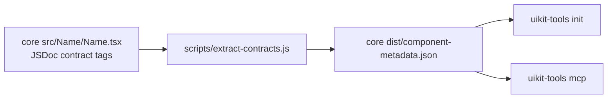
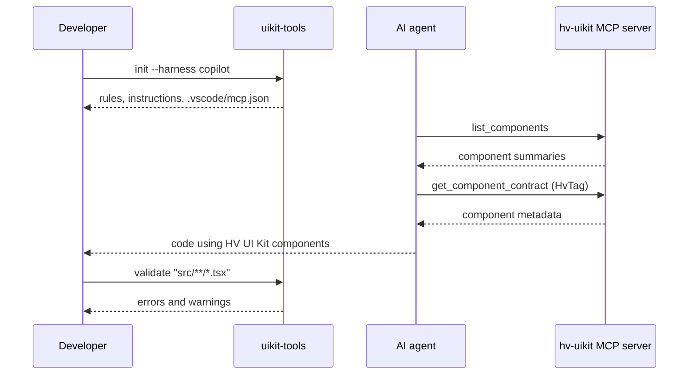

# @pentaho/uikit-tools

CLI and MCP server for consumers of HV UI Kit. It generates agent guidance for a project, serves component contracts to AI coding agents over MCP, and validates HV UI Kit usage in source files.

- Package: `@pentaho/uikit-tools` (version 1.0.0)
- Binary: `uikit-tools` (`dist/cli.js`)
- Data source: `component-metadata.json`, produced by `@pentaho/uikit-react-core`

## Contents

- [Commands](#commands)
- [MCP tools](#mcp-tools)
- [Architecture: library side](#architecture-library-side)
- [Architecture: client app side](#architecture-client-app-side)
- [Known limitations](#known-limitations)
- [Development](#development)

## Commands

### `init [targetDir]`

Generates agent guidance for a project. `targetDir` defaults to the current directory and `--harness` defaults to `copilot`.

```bash
npx --no-install uikit-tools init . --harness copilot
npx --no-install uikit-tools init . --harness claude
```

| Harness             | Files written                                                                      |
| ------------------- | ---------------------------------------------------------------------------------- |
| `copilot` (default) | `.github/copilot-instructions.md`, `.github/rules/hv-uikit.md`, `.vscode/mcp.json` |
| `claude`            | `.claude/instructions.md`, `.claude/rules/hv-uikit.md`                             |

- The rules file is generated from `templates/guide/hv-uikit.md` and includes the sections from `templates/rules/*.md`.
- The instructions file points the agent to the rules file and tells it to use the MCP server for component discovery.
- For `copilot`, `.vscode/mcp.json` gets an `hv-uikit` server entry. Other entries are kept. If the existing file is not valid JSON, `init` fails and does not overwrite it.
- The `claude` harness does not write an MCP config.
- An unknown harness value prints an error and exits with code 1.
- The summary lists components in three groups: full (purpose plus at least one contract tag), simple (purpose only), and no purpose (missing the purpose tag).

Running `init .` inside this monorepo overwrites the repository's own `.github/` and `.vscode/` files. Use a temporary directory when testing.

### `validate <paths...>`

Checks source files against the validation rules.

```bash
npx --no-install uikit-tools validate "src/**/*.tsx"
```

- Quote glob patterns so the shell does not expand them.
- Prints each error or warning with file, line, column, and a suggested fix.
- Exits with code 1 when there is at least one error or when no files match. Otherwise exits with code 0.
- `--fix` is declared but not implemented.
- Coverage is limited: rules are hard-coded in [src/validation/rules.ts](src/validation/rules.ts) for `HvButton` and `HvAvatar` only. The validator does not read `component-metadata.json`. See [Known limitations](#known-limitations).

### `mcp`

Starts a stdio MCP server named `hv-uikit-mcp`. It loads the metadata at startup and logs the component count to stderr.

```bash
npx --no-install uikit-tools mcp
```

## MCP tools

| Tool                     | Input                             | Returns                                                                                                                            |
| ------------------------ | --------------------------------- | ---------------------------------------------------------------------------------------------------------------------------------- |
| `list_components`        | `limit?`, `offset?`               | `components` (`name`, `displayName`, `purpose`), `total`, `offset`, `limit`                                                        |
| `get_component_contract` | `component` (for example `HvTag`) | The component's metadata entry: purpose, contract tags, and props. Unknown names return an error listing the available components. |

## Architecture: library side

The library side is `@pentaho/uikit-react-core`. Contract data is written in JSDoc in the component source and turned into JSON at build time. The tools package only reads that JSON.



### Build pipeline

- The core `build` script runs `vite build && npm run extract:contracts`.
- The order matters. `vite build` empties `dist/`, so extraction runs after it. Running extraction first would delete its own output.
- `npm run extract:contracts -w packages/core` regenerates the metadata without a full build.

### Extractor

[packages/core/scripts/extract-contracts.js](../core/scripts/extract-contracts.js) does the following:

- Scans `src/<Name>/<Name>.tsx` for each component folder and uses the component name `Hv<Name>`.
- Components without a purpose tag go to `missingPurpose` and are left out of `components`.
- Parses contract tags with regular expressions into structured arrays: `variantSemantics`, `stateRules`, `tokenConstraints`, `antiPatterns`, `a11y`, and `validationRules`. The raw tags are kept in `tags`.
- Reads props with the TypeScript compiler API. One shared program is used for all components. Only props declared under `src/` are kept, so React's built-in HTML attributes are excluded. `required` comes from the optional flag, and `description` comes from the prop's JSDoc.
- Writes `dist/component-metadata.json` and prints a summary.

The tag syntax and the regex rules are documented in [component-contracts.instructions.md](../../.github/instructions/component-contracts.instructions.md). Check that file before writing contract tags.

### Output shape

```json
{
  "version": "7.0.0",
  "generatedAt": "2026-10-16T14:00:49.726Z",
  "components": [
    {
      "name": "HvTag",
      "displayName": "Tag",
      "purpose": "...",
      "variantSemantics": [{ "name": "semantic", "description": "..." }],
      "stateRules": [{ "name": "selected", "description": "...", "rules": [] }],
      "tags": {},
      "props": [
        {
          "name": "color",
          "type": "...",
          "required": false,
          "description": "..."
        }
      ]
    }
  ],
  "missingPurpose": ["HvExample"]
}
```

The build at the time of writing produced 73 components. Five had no purpose tag.

## Architecture: tools package

The tools package is an ESM TypeScript package built with `tsc`.

| Module                                                     | Responsibility                                                                                                           |
| ---------------------------------------------------------- | ------------------------------------------------------------------------------------------------------------------------ |
| [src/cli.ts](src/cli.ts)                                   | Commander entry point. Defines `init`, `validate`, and `mcp`.                                                            |
| [src/commands/init.ts](src/commands/init.ts)               | Loads metadata, renders templates, writes harness files, and merges the MCP config.                                      |
| [src/commands/mcp.ts](src/commands/mcp.ts)                 | MCP server (`@modelcontextprotocol/sdk`, stdio transport) with the `list_components` and `get_component_contract` tools. |
| [src/commands/validate.ts](src/commands/validate.ts)       | Expands glob patterns, runs the validator, prints results, and sets the exit code.                                       |
| [src/validation/validator.ts](src/validation/validator.ts) | Scans JSX for the supported components and extracts simplified prop values (string, boolean, and expression markers).    |
| [src/validation/rules.ts](src/validation/rules.ts)         | Hard-coded rules for `HvButton` and `HvAvatar`.                                                                          |
| [src/utils/metadata.ts](src/utils/metadata.ts)             | `loadMetadata()` and `findComponent()`, plus TypeScript interfaces for the metadata.                                     |
| [src/test-mcp-client.ts](src/test-mcp-client.ts)           | MCP test client. [test-mcp.sh](test-mcp.sh) runs it against the built server.                                            |
| [templates/](templates)                                    | `guide/hv-uikit.md`, `instructions/instructions.md`, and `rules/*.md`.                                                   |

`init` flow: `loadMetadata()` → summarize components → render templates (`{{NAME}}` placeholders) → write files → update `.vscode/mcp.json` (copilot only).

## Architecture: client app side

A consumer app gets its agent setup from `init`. The agent then calls the MCP server for component facts, and `validate` checks the code the agent writes.



### Setup

1. Install `@pentaho/uikit-react-core` and `@pentaho/uikit-tools` as dev dependencies.
2. Run `npx --no-install uikit-tools init . --harness copilot` (or `claude`).
3. Commit the generated files.
4. Copilot starts the MCP server from `.vscode/mcp.json`:

   ```json
   {
     "servers": {
       "hv-uikit": {
         "type": "stdio",
         "command": "npx",
         "args": ["--no-install", "uikit-tools", "mcp"]
       }
     }
   }
   ```

5. Run `validate` locally or in CI.
6. After upgrading core, run `init` again to refresh the generated guide. Regeneration is not automatic (see [Known limitations](#known-limitations)).

The `--no-install` flag makes `npx` use the local `uikit-tools` binary and never download a package.

## Known limitations

These are current behaviors, not planned fixes.

1. **`validate` covers two components.** It uses hard-coded rules for `HvButton` and `HvAvatar` and does not read the metadata. The generated guide tells agents to validate their code, but most components are not checked.
2. **Some defined rules do not fire.** [src/validation/rules.ts](src/validation/rules.ts) defines eight rules. Running `validate` on [test-fixtures/validation-violations.tsx](test-fixtures/validation-violations.tsx) reports 5 errors and 1 warning. Rules `no-raw-colors`, `selected-toggle-semantics`, `icon-only-needs-aria-label`, and `no-image-and-initials` are not reported. The validator's simplified prop extraction is the likely cause; this has not been traced in detail. The fixture header says it has about 8 violations.
3. **`--fix` is not implemented.** The flag is declared in the CLI and does nothing.
4. **Metadata lookup works only in the monorepo.** [src/commands/mcp.ts](src/commands/mcp.ts) resolves `../../../core/dist/component-metadata.json` relative to its own file. [src/utils/metadata.ts](src/utils/metadata.ts) tries a `node_modules` candidate, then a dev fallback. Both are relative paths computed from the package's `dist` folder. Working through the path logic for a registry install, neither path reaches `@pentaho/uikit-react-core`, so `mcp` and `init` would fail to load metadata. This has not been run in a registry install. The `node_modules` candidate in `metadata.ts` also resolves to a nonexistent folder even in the monorepo, and the dev fallback is what works there.
5. **Regeneration is manual.** The generated guide says it is "Regenerated on `npm install`". No package in this repo has a `postinstall` hook. The guide is regenerated only when `init` is run.
6. **Interfaces do not match the output.** The `ComponentMetadata` interfaces in [src/utils/metadata.ts](src/utils/metadata.ts) (`AntiPattern`, `A11yRequirement`, `ValidationRule`) do not match what the extractor writes. The MCP server returns the raw JSON, so served data is not affected, but TypeScript types for those fields are not reliable.
7. **Unused dependency.** `ts-morph` is declared in `package.json` but not used by the validator.
8. **Stale build output.** `dist/guidance/` has no matching source in `src/` and can be deleted.

## Development

```bash
# Build metadata (vite build, then extraction)
npm run build -w packages/core

# Regenerate metadata only
npm run extract:contracts -w packages/core

# Build the tools package
npm run build -w packages/tools

# Unit tests (vitest)
npm test -w packages/tools

# Generate into a temporary directory instead of the repo
node packages/tools/dist/cli.js init /tmp/hv-init-check --harness copilot

# Validate the fixture (exits 1 by design: 5 errors, 1 warning)
node packages/tools/dist/cli.js validate "packages/tools/test-fixtures/validation-violations.tsx"

# Exercise the MCP server with the test client (run from the repo root)
packages/tools/test-mcp.sh list_components --limit 3
packages/tools/test-mcp.sh get_component_contract --component HvAvatar
```

The `test-mcp.sh` commands need the core metadata and the tools build. Run the build steps first.
